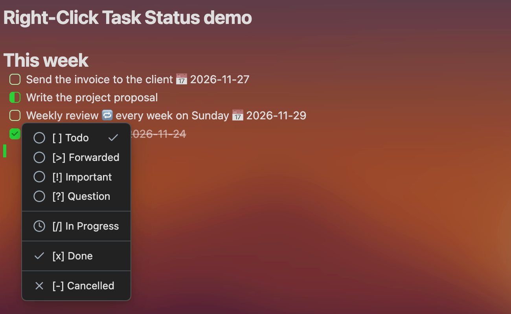
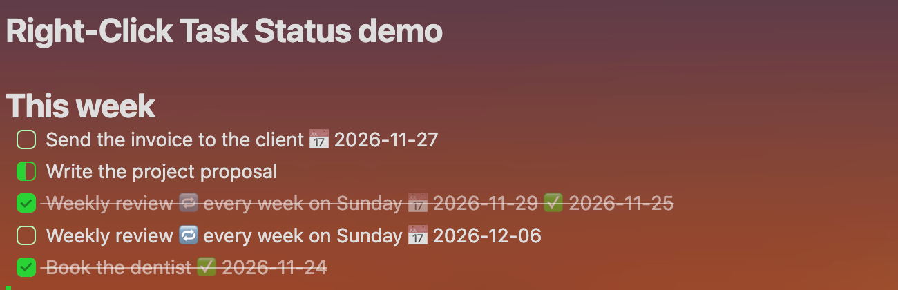
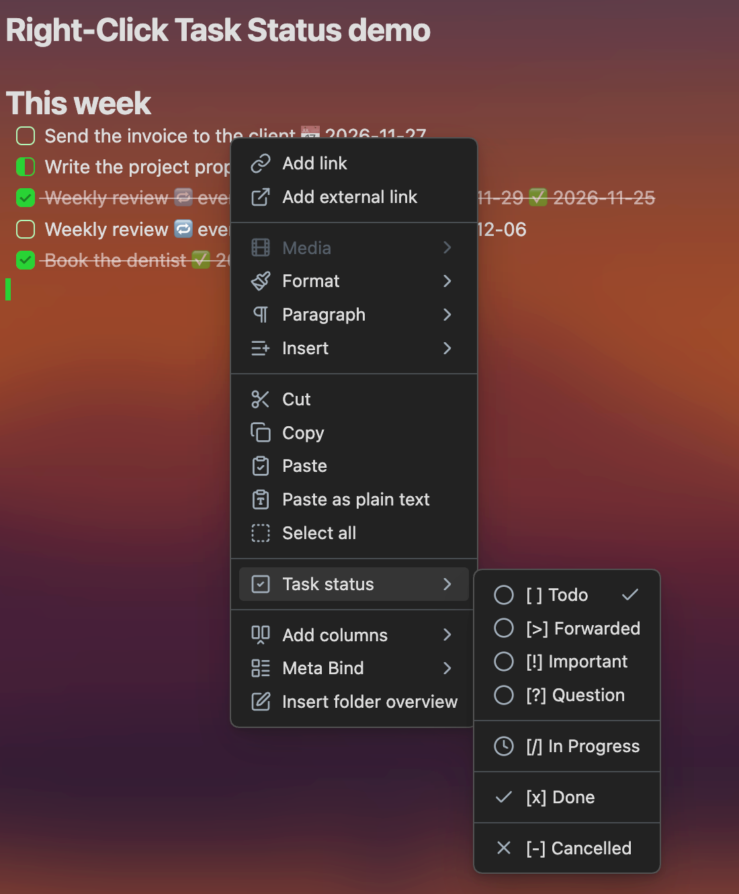
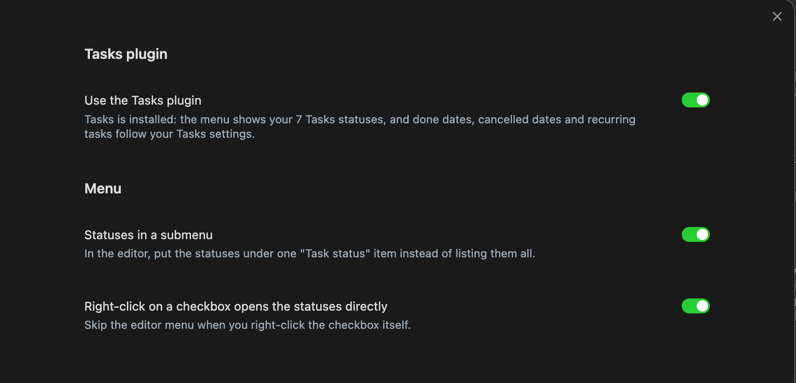

# Right-Click Task Status

Right-click any task in your notes and pick its status. No typing symbols between brackets, no remembering which character means "in progress".

## Made for the Tasks plugin

If you use [Tasks](https://github.com/obsidian-tasks-group/obsidian-tasks), this plugin works through it, so a status change behaves exactly like it does in Tasks:

- **Your Tasks statuses.** The menu lists the statuses from your Tasks settings, custom ones included, grouped by type: to do, in progress, done, cancelled.
- **Recurring tasks keep recurring.** Mark a `🔁` task done and the next occurrence is created, just like clicking its checkbox.
- **Done and cancelled dates** (`✅`, `❌`) are added when your Tasks settings say so.
- **Your other Tasks settings apply too:** where the new occurrence goes (above or below), the global filter and the task format.

Change a status in Tasks' settings and the menu follows. Nothing to set up twice.

## Right-click where you are

- **Checkbox:** right-click the checkbox to open the status menu straight away.
- **Task text in the editor** (Live Preview and source mode): a **Task status** submenu is added to Obsidian's own right-click menu.
- **Reading view:** right-click a task to open the status menu.

In the editor, every change is one step you can undo with Ctrl/Cmd+Z.

## Without the Tasks plugin

The plugin also works on its own. It then uses its own status list (Todo, In progress, Done, Cancelled by default), which you can edit in the settings: each status is one character, a name and a type. Only the character between the brackets changes.

## Settings

- **Use the Tasks plugin:** on by default when Tasks is installed. Turn it off to use the plugin's own statuses.
- **Statuses in a submenu:** keep the editor menu short with one "Task status" item, or list every status directly.
- **Right-click on a checkbox opens the statuses directly:** on by default.

## Installation

**From Obsidian:** Settings → Community plugins → Browse → search for "Right-Click Task Status" → Install → Enable.

**Manually:** download `main.js`, `manifest.json` and `styles.css` from the [latest release](https://github.com/toto1384/obsidian-right-click-task-status/releases/latest), put them in `<your vault>/.obsidian/plugins/right-click-task-status/`, then enable the plugin in Settings → Community plugins.

## Phone and tablet

Long-press a task instead of right-clicking.

## Also by me

[Right-Click Tag Colors](https://github.com/toto1384/obsidian-right-click-tag-colors): right-click any tag to give it a color.

## License

[MIT](LICENSE)
